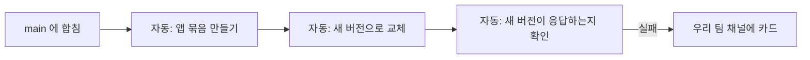
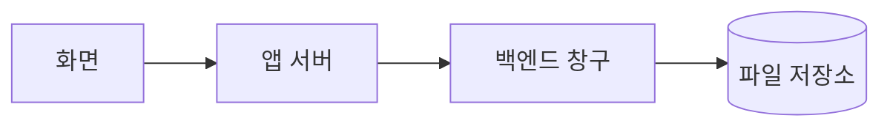

# Azure

> 읽는 사람: 현업

## 역할

| 무엇 | 현업이 하는 것 | 전산팀이 하는 것 | 요청 방법 |
| --- | --- | --- | --- |
| 앱이 도는 서버 | — | 만들고 운영 | — |
| 배포 | main 에 합치면 자동 | 배포 길(인증 · 연결) 준비 | 이슈 「전산팀에 부탁」 |
| 설정 값(환경 변수) | 필요한 값을 요청 | 넣고 관리 | 이슈 「전산팀에 부탁」 |
| 비밀(키 · 토큰) | **만지지 않음** | 보관 · 교체 | 이슈 「전산팀에 부탁」 |
| 메모리 · 서버 대수 | 부족하면 알림 | 조정 | 이슈 「전산팀에 부탁」 |
| 파일 저장소 | 화면의 올리기 기능으로 사용 | 저장소 · 창구 준비 | 이슈 「DB 요청」 |
| 사내망 연결 | — | 운영 | — |
| Azure 포털 | **권한 없음** | 전부 | — |

!!! note "현업은 Azure 에 들어갈 일이 없습니다"
    - 권한이 없고, 필요하지도 않습니다.
    - 배포는 GitHub 에서 자동으로 됩니다.
    - Azure 에서 바꿀 것이 있으면 이슈로 요청합니다.

## 배포는 이렇게 된다

- 비밀번호 없이 인증합니다. 저장소에 Azure 비밀을 두지 않습니다.

## 파일을 저장할 때

| 알아 둘 것 | 내용 |
| --- | --- |
| 브라우저가 저장소에 직접 붙지 않음 | 파일 링크를 복사해 남에게 줄 수 없음. 받는 사람도 로그인해서 화면에서 받음 |
| 내 PC 에서는 올리기 · 내려받기 시험이 안 됨 | 정상. 배포한 뒤 운영 화면에서 확인 |
| 지우기는 표시만 | 잘못 지웠으면 이슈로 전산팀에 알림 |
| 새 화면에 파일 칸이 필요함 | 이슈로 요청 — 어떤 파일 · 형식 · 크기 · 보관 기한 · 누가 보고 지우나 |

!!! warning "하지 않는 것"
    - 「내 PC 에서 안 되니까」 PC 디스크 · 브라우저에 대신 저장하게 고치기 — 화면은 도는데 파일이 조용히 사라집니다.
    - 저장소 키 · 접속 문자열을 찾아 코드에 넣기 — 넣을 자리가 없고, 넣어도 막힙니다.

## 이럴 때 요청한다

| 증상 | 요청 |
| --- | --- |
| 「메모리 부족 임박」 카드가 자주 옴 | 메모리 상향 |
| 새 외부 서비스 키가 필요함 | 설정 값 추가 |
| 접속할 수 있는 곳(IP 범위)을 바꿔야 함 | 접속 제한 변경 |
| 운영 주소를 바꾸거나 추가해야 함 | 주소 등록 |

정본: 각 앱 저장소의 표준 문서(배포 표준 · 파일 저장)
