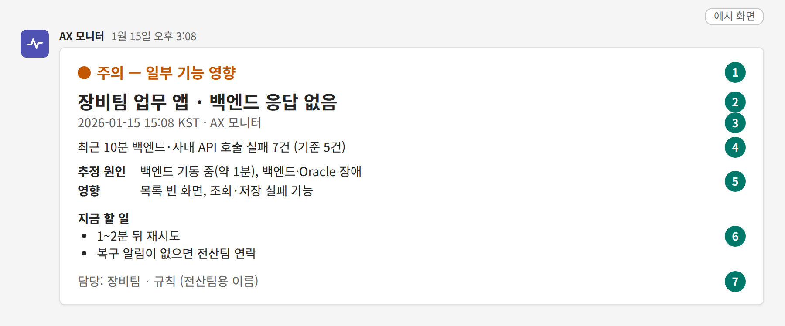
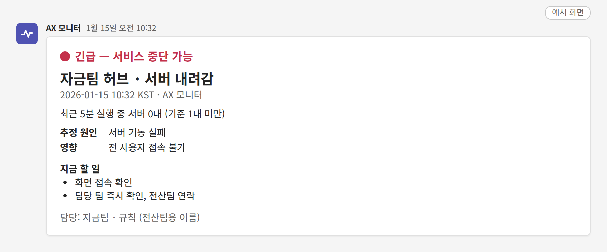
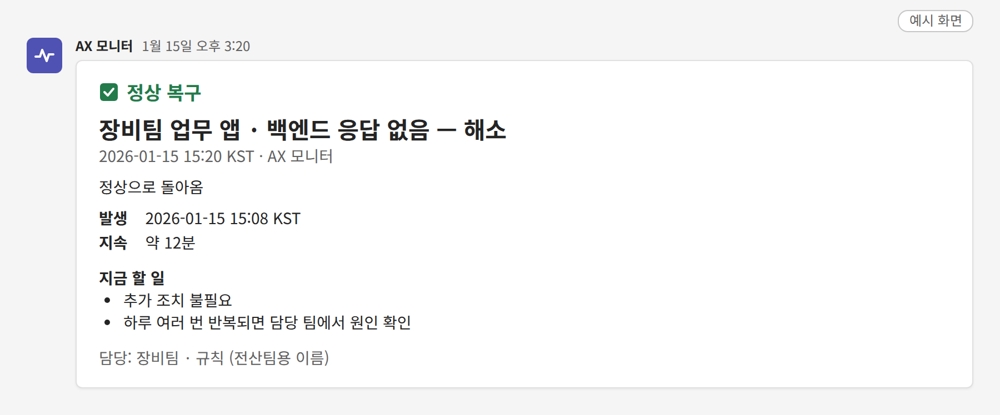
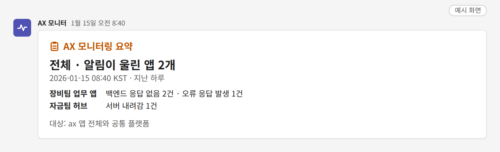
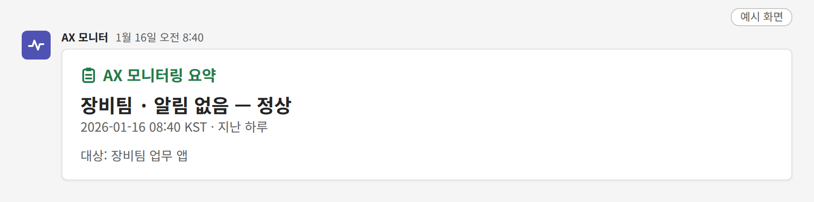
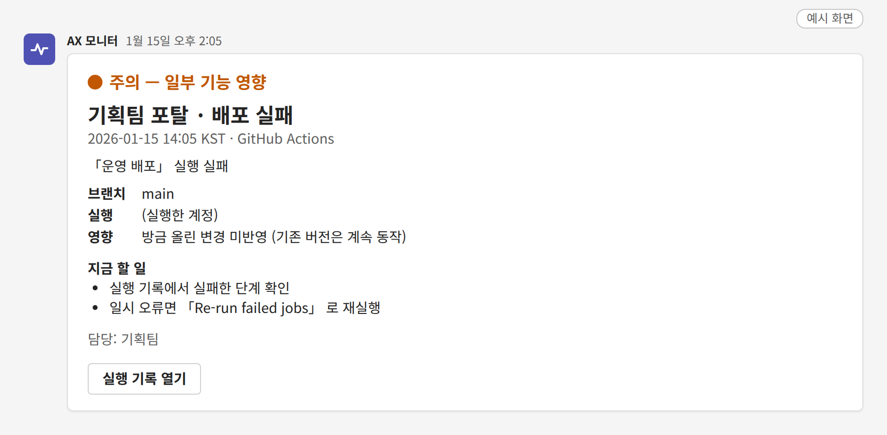

# 알림 카드 읽는 법

> 읽는 사람: 현업 · 전산팀

## 카드 생김새

- **예시 화면**입니다. 날짜 · 건수는 지어낸 값입니다.
- 초록 동그라미 번호는 설명용입니다. 실제 카드에는 없습니다.

| 번호 | 칸 | 읽는 법 |
| --- | --- | --- |
| ① | 등급 | 얼마나 급한지. 글자 색으로도 가립니다. 아래 「등급 세 가지」 |
| ② | 앱 이름 · 무슨 일 | 맨 앞이 **앱 이름**, 뒤가 **무슨 일**. 한 채널에 여러 앱이 섞여도 앞머리로 가립니다 |
| ③ | 시각 | 문제가 시작된 때 |
| ④ | 상황 | 숫자로 본 상황. 「기준」은 알림이 울리는 선입니다 |
| ⑤ | 추정 원인 · 영향 | 흔한 원인과 사용자에게 보이는 증상. 원인은 **추정**입니다 |
| ⑥ | 지금 할 일 | 위에서부터 차례로 합니다 |
| ⑦ | 담당 | 먼저 확인할 팀. 뒤의 「규칙 …」은 전산팀이 찾아볼 때 쓰는 이름표입니다 |

## 등급 세 가지

| 표시 | 색 | 뜻 | 대응 |
| --- | --- | --- | --- |
| 🔴 긴급 — 서비스 중단 가능 | 빨강 | 앱을 못 쓰거나 곧 못 쓰게 됨 | 바로 확인. 전산팀 채널에도 같이 감 |
| 🟠 주의 — 일부 기능 영향 | 주황 | 일부 화면 · 기능이 실패하거나 느림 | 업무 중에 확인 |
| 🟡 참고 — 당장 영향 없음 | 기본색 | 지금은 괜찮지만 알아 둘 것 | 시간 날 때 확인 |

- 긴급 카드 **예시 화면**입니다. 등급 줄만 빨강이고 나머지 구성은 같습니다.

## 복구 카드

- **예시 화면**입니다. 원인 · 영향 자리에 **발생 시각 · 지속 시간**이 옵니다.

- 장애 카드와 **같은 제목에 「— 해소」**가 붙습니다. 짝을 맞춰 보면 됩니다.
- 복구 카드가 오면 그 건은 끝입니다.
- 같은 알림이 하루에 여러 번 왔다 풀렸다 하면 원인을 봐야 합니다.

## 아침 요약 카드

- **예시 화면**입니다. 위는 알림이 있던 날(전산팀 채널), 아래는 없던 날(팀 채널)입니다.
- 앱마다 한 줄: 왼쪽이 앱 이름, 오른쪽이 알림 종류 · 건수

- **언제**: 평일 아침 08:40
- **어디로**: 채널마다 한 장 — 팀 채널에는 그 팀 앱만, 전산팀 채널에는 전체
- **기간**: 지난 하루. 월요일은 주말을 포함한 지난 사흘
- **알림이 없었으면**: 「알림 없음 — 정상」으로 옵니다
- **건수**: 알림이 울린 횟수입니다(울렸다 풀린 것도 1건)

## 배포 · 예약 작업 실패 카드

- **예시 화면**입니다. 「실행」 칸에는 그 작업을 돌린 GitHub 계정이 나옵니다.

| 제목 | 뜻 |
| --- | --- |
| 배포 실패 | main 가지에 올린 변경이 운영에 반영되지 않음. **기존 버전은 계속 동작** |
| 예약 작업 실패 | GitHub 이 정해진 시간에 돌리는 작업이 실패. 그 작업이 채우는 자료가 갱신되지 않음 |

- main 가지의 실패만 옵니다. 개발 가지 · PR 검사 실패는 오지 않습니다.
- 「실행 기록 열기」 단추로 GitHub 의 그 실행 화면이 열립니다.

## 「로그 부족 — 코드 개선 필요」 안내

- 장애가 아닙니다. 🟡 참고 등급으로 **한 번만** 옵니다.
- 뜻: 앱이 실패 상황을 기록(로그)으로 남기지 않아, 원인별 알림을 걸 수 없다는 안내
- 영향: 장애가 나도 「오류 응답 발생」 같은 공통 알림만 오고, 「백엔드 응답 없음」처럼 원인을 짚는 알림은 못 옴
- 할 일: [새 앱을 올릴 때](new-app.md)의 「실패하면 한 줄 기록」대로 코드를 고친 뒤 전산팀에 알림 추가 요청

## 테스트 카드

- 맨 앞에 **`[테스트 — 무시하세요]`** 가 붙은 카드는 전산팀이 연결을 확인하려고 보낸 것입니다.
- 할 일이 없습니다.
