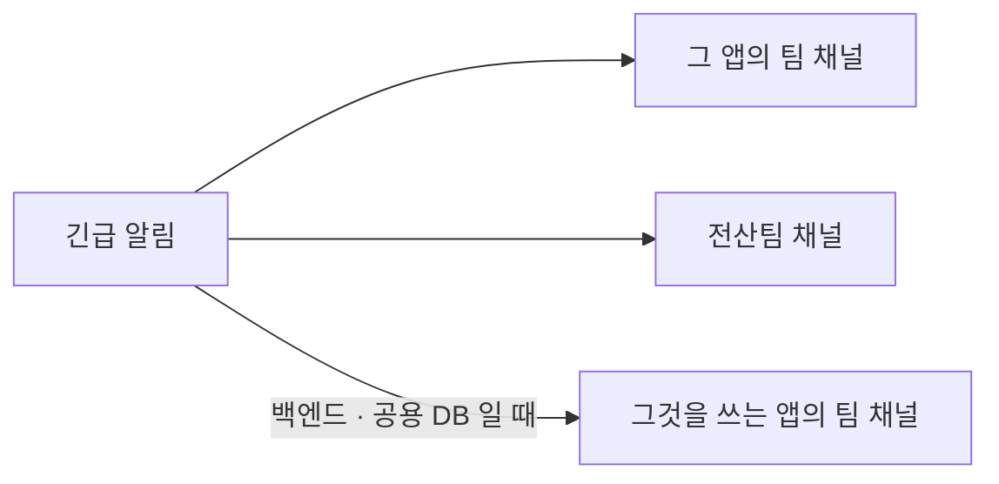

# 알림이 오는 채널

> 읽는 사람: 현업 · 전산팀

알림은 Teams 팀 **「SINOKOR AX」**의 팀 채널로 옵니다.

## 앱 → 채널 → 담당

| 앱 | 채널 | 담당 |
| --- | --- | --- |
| 장비팀 업무 앱 | 장비팀 | 장비팀 |
| 자금팀 허브 | 자금팀 | 자금팀 |
| 기획팀 포탈 | 기획팀 | 기획팀 |
| 운항 통합 플랫폼 · 운항 메일 워커 | 운항팀 | 운항팀 |
| 인사·총무 앱 | 총무팀 | 총무팀 |
| SVMS 웹 | 시노코쉽매니지먼트 | 시노코쉽매니지먼트 |
| 심사팀 업무 앱 | 심사팀 | 심사팀 |
| 흥아 앱 | 흥아해운 | 흥아해운 |
| 보험팀 앱 | 보험팀 | 보험팀 |
| 실적보고서 · AX 포털 | 전산팀 | 전산팀 |
| AX 공통 플랫폼 — 로그인 · 백엔드 · 데이터 적재 작업 · 공용 DB · 사내망 연결 | 전산팀 | 전산팀 |

- 담당은 **GitHub 에서 그 앱 저장소에 연결된 팀**을 따릅니다.
- 담당 팀이 바뀌면 전산팀에 알립니다. 카드의 담당과 채널을 같이 바꿉니다.

## 긴급 알림은 여러 곳에 같이 간다

| 무엇이 긴급일 때 | 같이 받는 팀 채널 |
| --- | --- |
| 어느 앱이든 | 전산팀 |
| 장비 · 보험 · 운항 앱이 쓰는 백엔드 | 장비팀 · 보험팀 · 운항팀 |
| 심사 앱이 쓰는 백엔드 | 심사팀 |
| 인사·총무 앱이 쓰는 백엔드 | 총무팀 |
| SVMS 웹이 쓰는 백엔드 | 시노코쉽매니지먼트 |
| 공용 DB | 자금팀 · 기획팀 · 운항팀 |

- 백엔드 · 공용 DB 가 멈추면 그것을 쓰는 앱도 같이 멈춥니다. 그래서 그 팀 채널에도 같은 카드가 갑니다.
- 이때 **팀이 할 일은 없습니다.** 조치는 전산팀이 합니다.
- 주의 · 참고 등급은 한 곳에만 갑니다.

## 전산팀 채널에 같이 오는 것

| 시스템 | 오는 것 |
| --- | --- |
| AX 앱 · 공통 플랫폼 | 장애 · 복구 · 아침 요약(전체) |
| 그 밖의 전산팀 운영 시스템 | 각 시스템의 장애 알림 · 정기 현황 |

- 카드 제목 맨 앞의 시스템 · 앱 이름으로 가려 봅니다.

## 채널 쓰는 법

| | |
| --- | --- |
| 보기 방식 | 모두 **채팅형** — 카드 아래에 바로 이어서 말을 달 수 있음 |
| 기록 | 채널에 단 말은 기록으로 남지 않음. 요청 · 결정은 이슈에 |
| 알림이 대화를 가리면 | 전산팀에 알림 |
