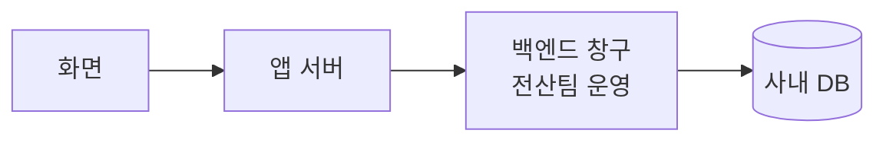
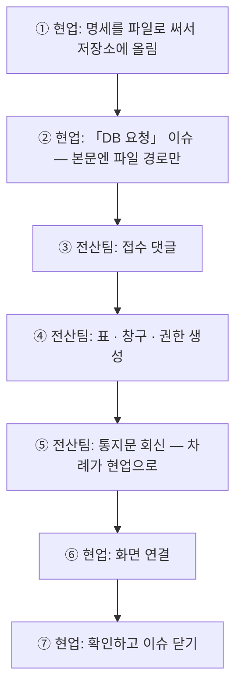

# DB 가 필요할 때

> 읽는 사람: 현업

## 역할

| 무엇 | 현업이 하는 것 | 전산팀이 하는 것 | 요청 방법 |
| --- | --- | --- | --- |
| 새 표 · 새 칸 | 무엇이 필요한지 명세로 씀 | 표를 만들고 권한을 줌 | 이슈 「DB 요청」 |
| 데이터 읽기 · 쓰기 | 화면에 연결 | 읽고 쓰는 창구(백엔드)를 만듦 | 이슈 「DB 요청」 |
| 이미 있는 사내 데이터 조회 | 어떤 값이 필요한지 알림 | 조회 창구 · 조회 권한 | 이슈 「DB 요청」 |
| 어느 DB 에 둘지 | 애매하면 먼저 물음 | 정함 | 이슈 「질문 · 결정」 |
| DB 접속 | **하지 않음** | 운영 | — |

!!! warning "앱은 DB 에 직접 붙지 않습니다"
    - 접속 주소 · SQL 을 화면 코드에 쓰지 않습니다.
    - 표를 만들거나 바꾸는 것도 앱이 하지 않습니다 — 앱에 그 권한이 없습니다.
    - 데이터는 전산팀이 만든 창구로만 오갑니다.

## 데이터가 오가는 길

## 요청하는 차례

## 명세에 적을 것

- [ ] 어느 화면에서 쓰는가
- [ ] 무엇이 필요한가 (표 · 칸 · 조회 조건 · 저장할 값)
- [ ] 화면이 받고 싶은 응답 모양 (예시는 **지어낸 값**으로)
- [ ] 급한 정도

## 창구가 생기기 전에

| 해도 되는 것 | 하면 안 되는 것 |
| --- | --- |
| 명세대로 지어낸 시험 값으로 화면 먼저 만들기 | 시험 값에 실명 · 실제 사번 · 거래처 이름 넣기 |
| 화면 모양 · 흐름 확인 | 운영 화면에 지어낸 데이터 넣기 |

## 통지문에 들어 있는 것

- 만들어진 표 · 칸
- 창구 주소와 요청 · 응답 예시
- 오류 코드

빠진 것이 있으면 이슈 댓글로 묻습니다.

정본: 각 앱 저장소의 「협업 방식」 · DB 요청 서식
