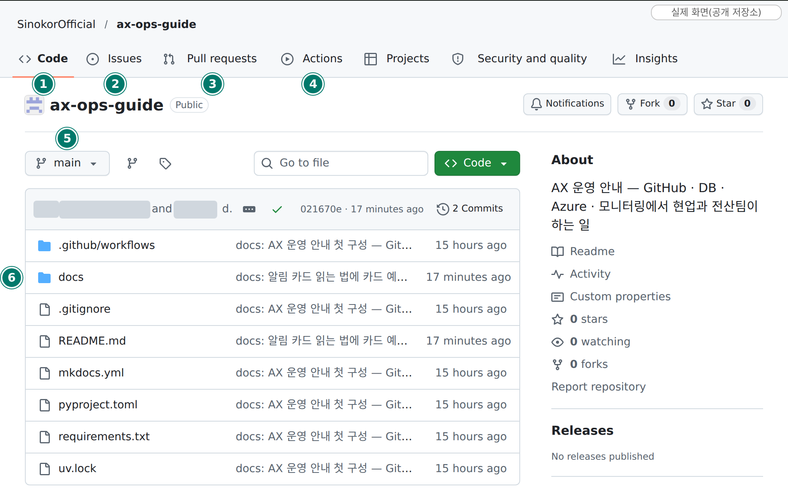
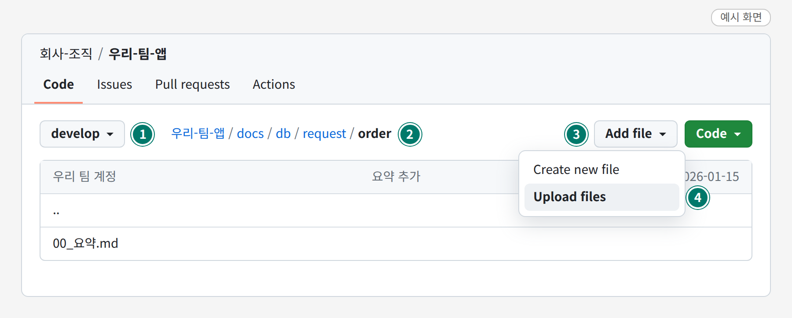
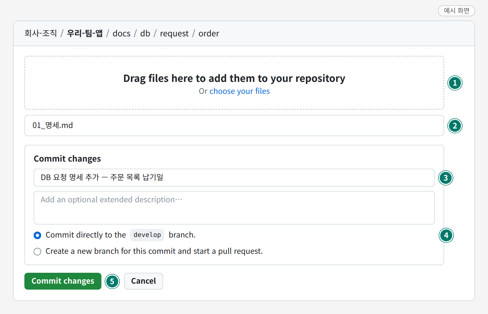
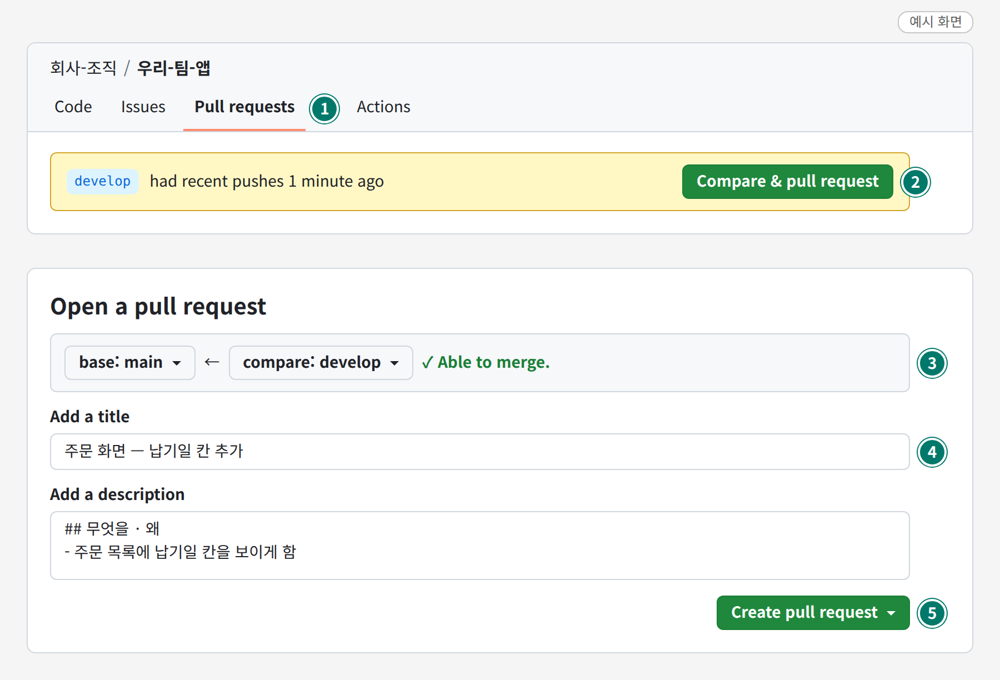
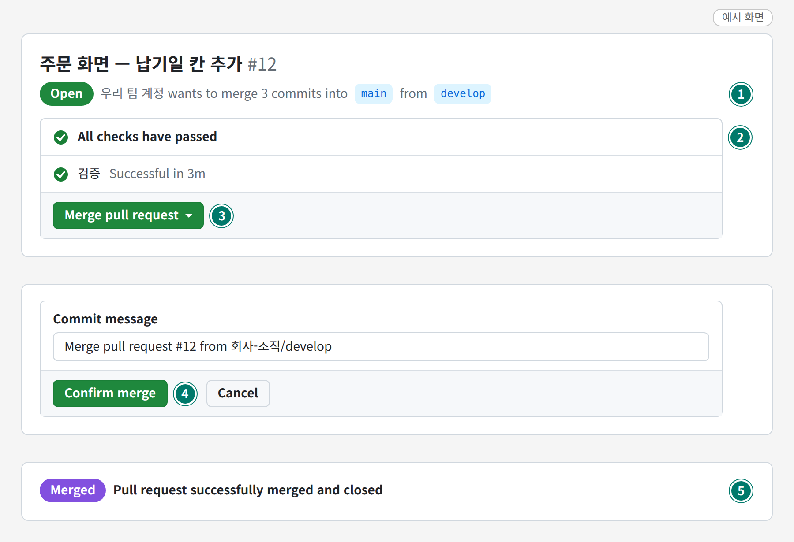
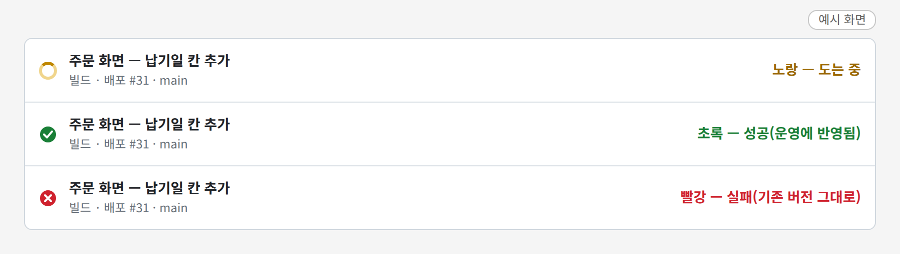
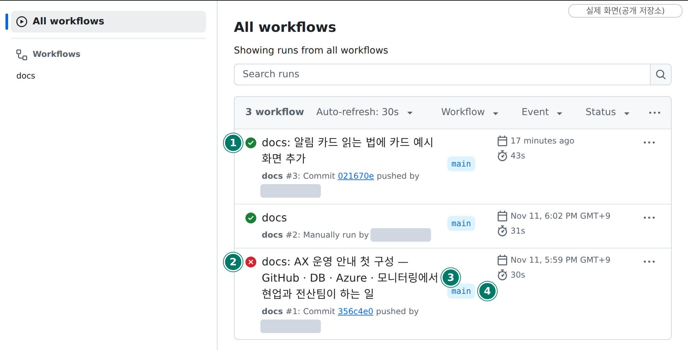
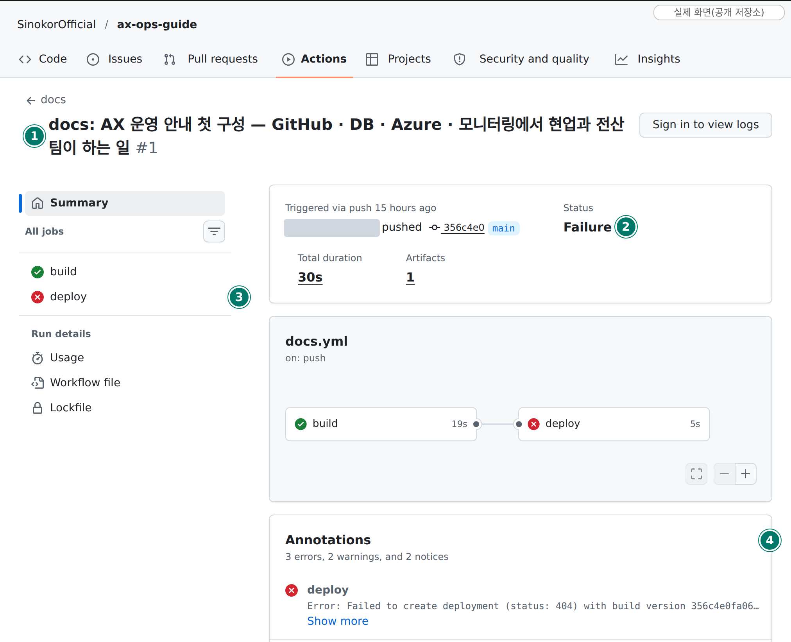

# GitHub 쓰는 법

> 읽는 사람: 현업

화면을 보며 차례대로 따라 합니다. 그림의 초록 동그라미 번호는 설명용이고, 실제 화면에는 없습니다.

| 차례 | 하는 일 | 어디서 |
| --- | --- | --- |
| 1 | [저장소 첫 화면 익히기](#1) | Code 탭 |
| 2 | [파일 올리기](#2) | Code 탭 › Add file |
| 3 | [PR 만들기 (develop → main)](#3-pr) | Pull requests 탭 |
| 4 | [합치기 — 운영에 배포됨](#4) | 그 PR 화면 |
| 5 | [배포 확인](#5) | Actions 탭 |

## 1. 저장소 첫 화면 { #1 }

- **실제 화면**입니다 — 이 문서 저장소(공개)를 로그인하지 않고 찍었습니다. 계정 이름은 회색으로 가렸습니다.
- 우리 팀 앱 저장소도 배치가 같습니다. 로그인하면 오른쪽에 `Add file` 단추가 더 보입니다.

| 번호 | 무엇 | 할 일 |
| --- | --- | --- |
| ① | Code — 파일이 있는 곳 | 파일을 보거나 올릴 때 |
| ② | Issues — 전산팀과 주고받는 곳 | 요청 · 질문할 때 → [요청하는 법](issues.md) |
| ③ | Pull requests — 합치기 요청 | develop 을 main 에 합칠 때 |
| ④ | Actions — 자동 실행 기록 | 배포가 됐는지 볼 때 |
| ⑤ | 가지(branch) 고르기 | 작업 전에 **develop** 으로 바꿈 |
| ⑥ | 파일 · 폴더 목록 | 눌러서 들어감 |

## 2. 파일 올리기 { #2 }

- **예시 화면**입니다. 저장소 이름 · 파일 이름은 지어낸 것입니다.

| 번호 | 무엇 | 할 일 |
| --- | --- | --- |
| ① | 가지 단추 | **develop** 인지 확인. `main` 이면 눌러서 develop 으로 바꿈 |
| ② | 지금 있는 폴더 | 파일 목록에서 폴더를 눌러 **올릴 폴더로 들어감** |
| ③ | `Add file` (파일 추가) | 누름 |
| ④ | `Upload files` (파일 올리기) | 누름 |

- **예시 화면**입니다.

| 번호 | 무엇 | 할 일 |
| --- | --- | --- |
| ① | 파일 놓는 칸 | 파일을 끌어다 놓거나 `choose your files` (파일 고르기). 폴더째 끌어다 놓아도 됨 |
| ② | 올라간 파일 | 이름과 맨 위의 폴더 경로가 맞는지 확인 |
| ③ | 설명 한 줄 | 무엇을 올렸는지 적음 |
| ④ | `Commit directly to the develop branch` | 이쪽이 골라져 있는지 확인 (develop 에 바로 넣기) |
| ⑤ | `Commit changes` (저장) | 누르면 develop 에 올라감 |

!!! warning "올리기 전에"
    - 가지가 `main` 이면 멈춥니다. main 에 올라가면 **바로 운영에 배포**됩니다.
    - 비밀(키 · 비밀번호) · 업무 데이터 파일(엑셀 · CSV)은 올리지 않습니다.
    - 이 화면은 명세 파일처럼 **파일 몇 개**를 올릴 때 씁니다. 코드 작업은 앱 저장소의 「작업 · 배포 절차」를 따릅니다.

## 3. PR 만들기 (develop → main) { #3-pr }

- **예시 화면**입니다.
- PR(Pull request) = 「develop 에 모인 것을 main 에 합쳐 달라」는 요청

| 번호 | 무엇 | 할 일 |
| --- | --- | --- |
| ① | `Pull requests` 탭 | 누름 |
| ② | `Compare & pull request` (비교하고 PR 만들기) | 누름. 노란 띠가 없으면 `New pull request` |
| ③ | 방향 | **base: main ← compare: develop** 인지 확인 |
| ④ | 제목 | 무엇을 바꿨는지 한 줄 |
| ⑤ | `Create pull request` (PR 만들기) | 누름 |

- PR 을 만들면 「검증」 검사가 저절로 돕니다.
- develop → main PR 은 **사람이 만듭니다.** AI 에게 시키지 않습니다.

## 4. 합치기 — 운영에 배포됨 { #4 }

- **예시 화면**입니다.

| 번호 | 무엇 | 할 일 |
| --- | --- | --- |
| ① | 방향 | `into main from develop` 인지 확인 |
| ② | `All checks have passed` (검사 통과) | **초록**일 때만 다음으로 |
| ③ | `Merge pull request` (합치기) | 누름 |
| ④ | `Confirm merge` (합치기 확인) | 누름 — **이 순간 운영 배포가 시작됩니다** |
| ⑤ | `Merged` (합쳐짐) | 보라색이면 끝. [5. 배포 확인](#5)으로 |

!!! warning "④ 를 누르기 전에"
    - 합치면 **운영 앱이 새 버전으로 바뀝니다.**
    - 월말 · 장애 중처럼 바뀌면 안 되는 때에는 합치지 않습니다.
    - 합친 뒤 `Delete branch` (가지 지우기) 단추가 보여도 **develop 은 지우지 않습니다.**

## 5. 배포 확인 — Actions { #5 }

- **예시 화면**입니다. 맨 앞 동그라미 색으로 가립니다.

| 색 | 뜻 | 할 일 |
| --- | --- | --- |
| 노랑(도는 중) | 배포하는 중 | 기다림 |
| 초록 | 성공 — 운영에 반영됨 | 운영 주소에서 로그인 → 첫 화면 → 고친 화면 확인 |
| 빨강 | 실패 — **기존 버전은 계속 동작** | 아래 [실패했을 때](#fail) |

- **실제 화면**입니다 — 이 문서 저장소의 Actions 탭. 계정 이름은 가렸습니다.
- 앱 저장소에서는 main 에 합치면 「빌드 · 배포」 실행이 한 줄 생깁니다.

| 번호 | 무엇 | 할 일 |
| --- | --- | --- |
| ① | 초록 표시 | 성공 |
| ② | 빨강 표시 | 실패 |
| ③ | 실행 제목(합친 변경의 제목) | **실패한 줄의 제목을 누름** → 아래 화면 |
| ④ | 가지 이름 | `main` 이 운영 배포 |

### 실패했을 때 { #fail }

- **실제 화면**입니다 — 이 문서 저장소에서 실제로 실패했던 실행. 계정 이름은 가렸습니다.
- 로그인하지 않아 오른쪽 위가 `Sign in to view logs` 로 나옵니다. 로그인하면 ③ 을 눌러 기록을 볼 수 있습니다.

| 번호 | 무엇 | 할 일 |
| --- | --- | --- |
| ① | 실행 제목 | 내가 합친 변경이 맞는지 확인 |
| ② | `Status` — `Failure` (실패) | — |
| ③ | 왼쪽 작업 목록 | **빨강인 줄을 누름** → 빨강으로 표시된 단계의 기록을 읽음 |
| ④ | `Annotations` (오류 요약) | 오류 한 줄을 먼저 읽음 |

| 무엇이 보이나 | 할 일 |
| --- | --- |
| 내 코드의 오류 | 고쳐서 다시 올림 |
| 잠깐 스친 오류 같음 | 오른쪽 위 `Re-run jobs` › `Re-run failed jobs` (실패한 것만 다시 실행) |
| 권한 · 연결 오류 | 이슈 「전산팀에 부탁」 — 실행 주소와 오류 문장을 적음 |
| 초록인데 요약에 「검증까지만 했습니다」 | 배포되지 **않은** 것. 이슈 「전산팀에 부탁」 |

- 우리 팀 채널에도 [「배포 실패」 카드](cards.md)가 옵니다.

## 역할

| 무엇 | 현업이 하는 것 | 전산팀이 하는 것 | 요청 방법 |
| --- | --- | --- | --- |
| 저장소 | 우리 팀 저장소에서 작업 | 저장소를 팀에 연결 · 권한 설정 | 이슈 「전산팀에 부탁」 |
| 코드 | 내 화면을 고쳐 올림 | 공통 부품 · 로그인 · 배포 설정 관리 | 이슈 |
| 운영 반영 | develop → main PR 을 만들고 합침 | 배포 길 준비 | 이슈 「전산팀에 부탁」 |
| 되돌리기 | 직전에 잘 돌던 버전으로 다시 배포 | Azure 쪽 조치 | 이슈 |
| 연락 | 이슈를 열고, 확인되면 닫음 | 이슈에 회신 | — |

## 가지는 둘

| 가지 | 뜻 | 규칙 |
| --- | --- | --- |
| develop | 작업이 모이는 곳 | 작업은 여기에 |
| main | 운영에 배포된 것 | develop → main PR 로만 들어감. **직접 올리지 않음** |

- main 에 합치는 순간 **운영에 배포**됩니다.
- develop → main PR 은 **사람이 만들고 사람이 합칩니다.** AI 에게 시키지 않습니다.

## 올리기 전 체크

- [ ] 고친 곳이 **내 화면**뿐인가 (공통 부품 · 설정 · 배포 파일은 건드리지 않음)
- [ ] 비밀(키 · 비밀번호 · 토큰)이 코드에 없는가
- [ ] 업무 데이터 파일(엑셀 · CSV) · 실명 · 사번이 들어가지 않았는가
- [ ] 같은 파일을 다른 사람이 고치고 있지 않은가

## 배포 뒤 체크

- [ ] 배포 실행이 초록(성공)인가
- [ ] 운영 주소에서 로그인 → 첫 화면 → 고친 화면이 되는가
- [ ] 이상하면 **바로 되돌리기** (직전에 잘 돌던 버전으로 다시 배포)

!!! note "배포가 실패하면"
    - 우리 팀 채널에 「배포 실패」 카드가 옵니다.
    - 실패해도 **기존 버전은 계속 동작**합니다.

## 요청은 이슈로

화면으로 따라 하기: [요청하는 법(이슈)](issues.md)

| 양식 | 언제 |
| --- | --- |
| 전산팀에 부탁 | 앱 등록 · 권한 · 배포 · 설정 |
| 질문 · 결정 | 정할 것 · 물어볼 것 |
| DB 요청 | 표 · 데이터 창구가 필요할 때 |

| 규칙 | 내용 |
| --- | --- |
| 창구 | 그 앱 저장소의 이슈 하나. 메신저 · 메일로 받은 것은 이슈로 옮김 |
| 차례 | 「주인」 라벨이 정함 — 공을 넘길 때 라벨을 바꿈 |
| 긴 내용 | 이슈에 길게 쓰지 않고 저장소에 파일로 올린 뒤 경로를 적음 |
| 닫기 | 현업이 화면에서 확인하고 닫음 |
| 적지 않는 것 | 이름 · 사번 · 이메일 · 접속 주소 · 비밀 · 조회 결과 원본 |

## 볼 수 있는 범위

| | 볼 수 있나 |
| --- | --- |
| 우리 팀에 연결된 저장소 | ✅ |
| 다른 팀 저장소 | ❌ 보이지 않음 |
| 전 직원 공용 문서 | ✅ 읽기만 |

정본: 각 앱 저장소의 「작업 · 배포 절차」 · 「협업 방식」, 조직의 GitHub 거버넌스 문서
