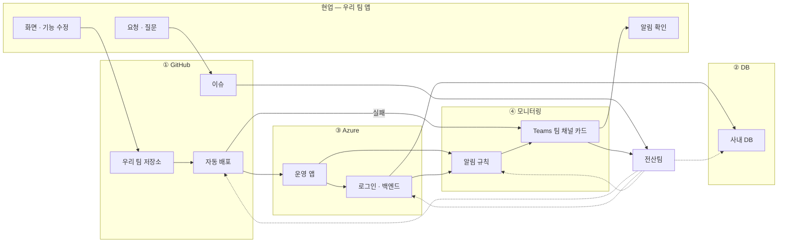

# 한눈에 보기

> 읽는 사람: 현업 · 전산팀

AX 운영 앱은 네 영역 위에서 돕니다 — **GitHub · DB · Azure · 모니터링.**
이 문서는 영역마다 **현업이 하는 것**과 **전산팀이 하는 것**을 나눠 적었습니다.

## 전체 그림

- 실선: 일이 흐르는 길 · 점선: 전산팀이 만들고 운영하는 것

## 한 장 요약

| 영역 | 현업이 하는 것 | 전산팀이 하는 것 | 요청 방법 |
| --- | --- | --- | --- |
| **① GitHub** | 우리 팀 저장소에 코드 올리기 · PR · 운영 반영 | 조직 · 팀 · 권한 · 배포 길 준비 | 이슈 「전산팀에 부탁」 |
| **② DB** | 필요한 데이터를 명세로 써서 요청 | 표 · 창구 · 권한을 만들어 회신 | 이슈 「DB 요청」 |
| **③ Azure** | 없음 (권한 없음 · 배포는 자동) | 자원 · 설정 · 비밀 · 사내망 연결 | 이슈 「전산팀에 부탁」 |
| **④ 모니터링** | 우리 팀 채널의 카드 확인 · 앱 문제 조치 | 알림 규칙 · 카드 · 채널 연결, 플랫폼 문제 조치 | 이슈 |

!!! note "기억할 세 가지"
    - 연락은 **GitHub 이슈** 하나로 합니다. 메신저 · Teams 대화는 기록이 남지 않습니다.
    - **main 에 합치면 운영에 배포**됩니다.
    - 앱은 **DB · Azure 에 직접 손대지 않습니다.** 필요하면 요청합니다.

## 어디부터 읽나

| 나는 | 읽을 쪽 |
| --- | --- |
| 현업 — 처음이다 | [내가 하는 일 · 전산팀이 하는 일](roles.md) |
| 코드를 올리고 배포하려 한다 | [GitHub 쓰는 법](github.md) |
| 새 데이터 · 표가 필요하다 | [DB 가 필요할 때](db.md) |
| 설정 · 메모리 · 파일 저장이 궁금하다 | [Azure](azure.md) |
| 알림 카드를 받았다 | [알림 카드 읽는 법](cards.md) · [알림 사전](alerts.md) |
| 새 앱을 올리려 한다 | [새 앱을 올릴 때](new-app.md) |
| 전산팀이다 | 위 전부 + 「전산팀용」 묶음 |
