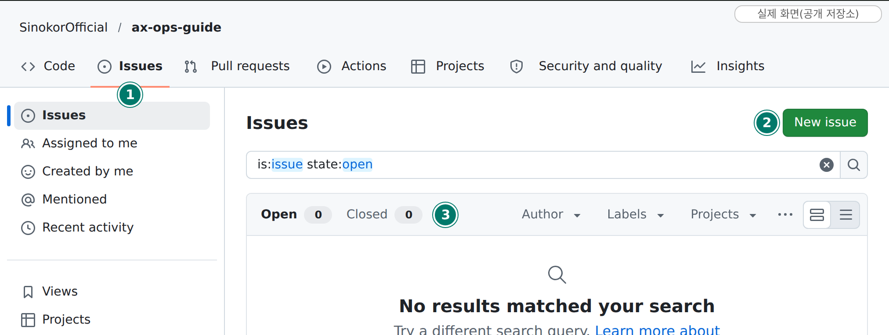
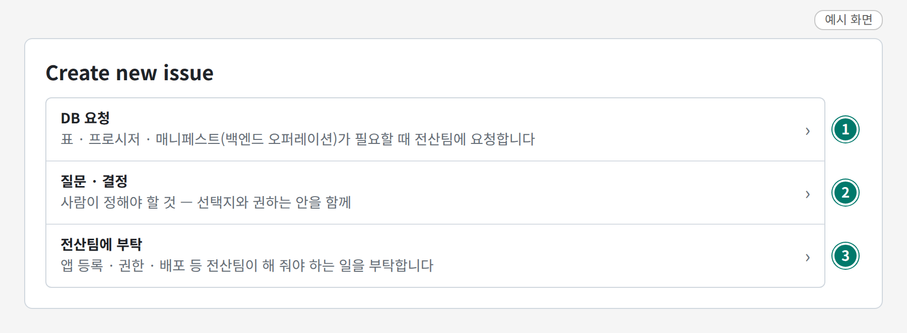
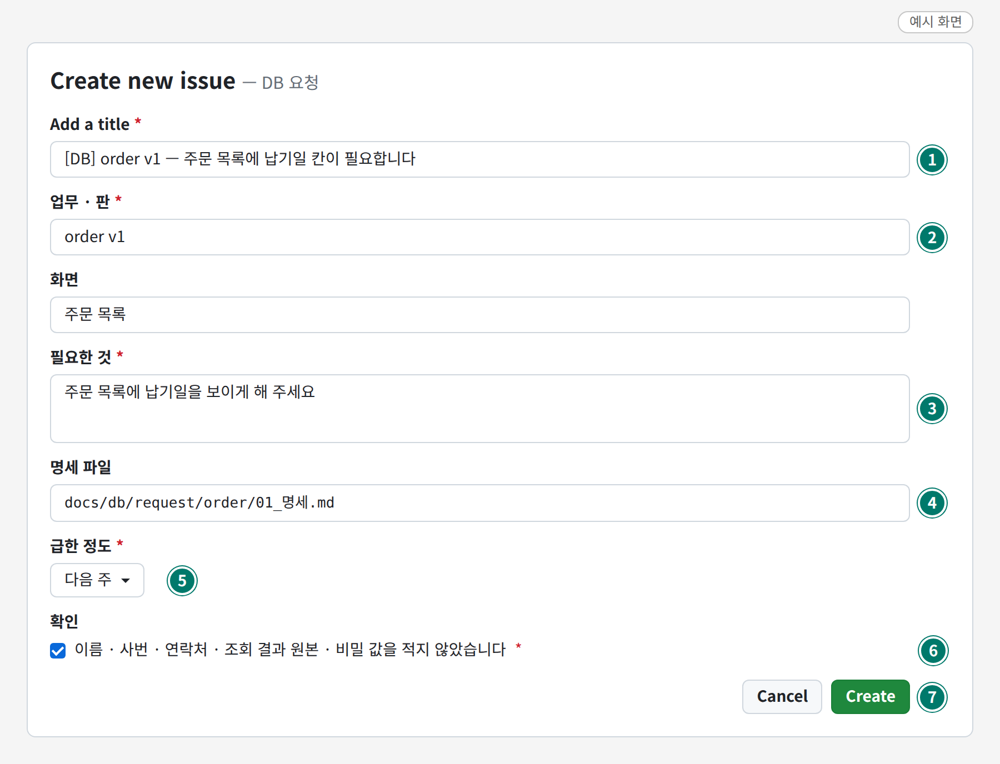
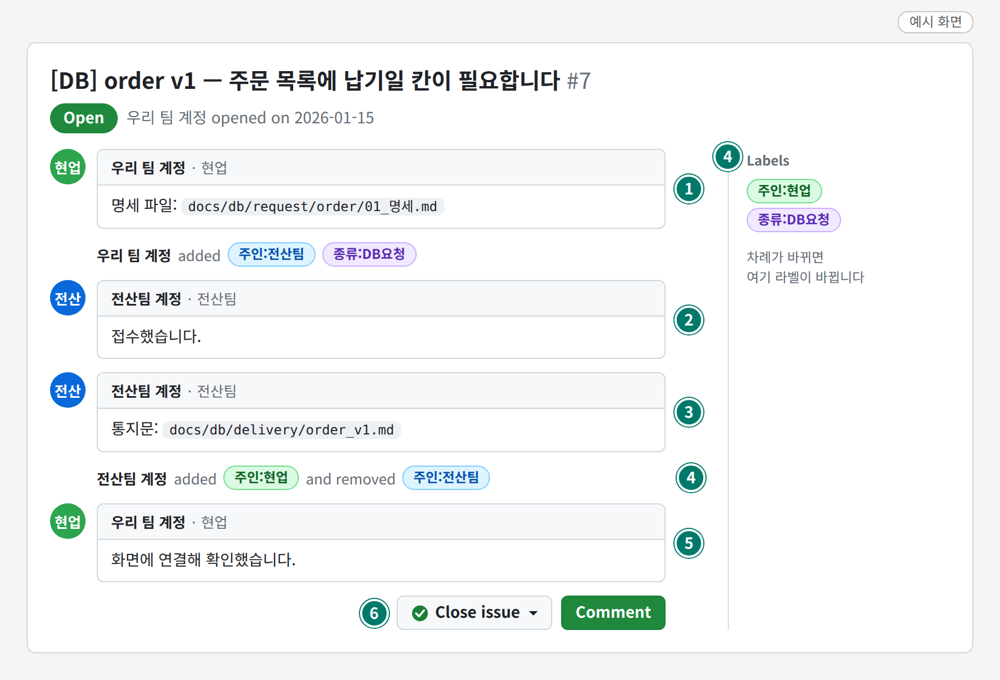

# 요청하는 법 (이슈)

> 읽는 사람: 현업

전산팀에 필요한 것은 **우리 팀 앱 저장소의 이슈**로 요청합니다. 그림의 초록 동그라미 번호는 설명용입니다.

| 차례 | 하는 일 |
| --- | --- |
| 1 | [이슈 새로 열기](#1) |
| 2 | [양식 고르기](#2) |
| 3 | [양식 채우기 — 「DB 요청」](#3-db) |
| 4 | [차례 주고받기 · 닫기](#4) |

## 1. 이슈 새로 열기 { #1 }

- **실제 화면**입니다 — 이 문서 저장소(공개)를 로그인하지 않고 찍었습니다. 앱 저장소도 같은 자리에 같은 단추가 있습니다.

| 번호 | 무엇 | 할 일 |
| --- | --- | --- |
| ① | `Issues` 탭 | 누름 |
| ② | `New issue` (새 이슈) | 누름 |
| ③ | `Open` · `Closed` (열림 · 닫힘) | 끝난 요청은 `Closed` 에서 찾음 |

## 2. 양식 고르기 { #2 }

- **예시 화면**입니다. 양식 이름 · 설명은 앱 저장소의 양식 그대로입니다.
- 빈 이슈는 막혀 있습니다. 셋 중 하나를 고릅니다.
- 화면 모양은 GitHub 판에 따라 조금 다를 수 있습니다(양식 옆에 `Get started` 단추가 따로 보이면 그것을 누름).

| 번호 | 양식 | 언제 고르나 |
| --- | --- | --- |
| ① | DB 요청 | 표 · 데이터 창구가 필요할 때 |
| ② | 질문 · 결정 | 정할 것 · 물어볼 것 |
| ③ | 전산팀에 부탁 | 앱 등록 · 권한 · 배포 · 설정 · 그 밖 |

## 3. 양식 채우기 — 「DB 요청」 { #3-db }

- **예시 화면**입니다. 적힌 값은 지어낸 것입니다. 빨간 `*` 는 꼭 채우는 칸입니다.
- 맨 아래 초록 단추의 글자는 GitHub 판에 따라 `Create` 또는 `Submit new issue` 입니다.
- 먼저 명세를 파일로 써서 저장소에 올려 둡니다 → [파일 올리기](github.md#2)

| 번호 | 칸 | 적는 것 |
| --- | --- | --- |
| ① | 제목 | `[DB] <업무> v<판> — <무엇이 필요한지 한 줄>` |
| ② | 업무 · 판 | 명세를 올린 폴더 이름과 판 |
| ③ | 필요한 것 | 한두 줄. 자세한 것은 명세 파일에 |
| ④ | 명세 파일 | 저장소에 올린 명세의 경로 (`docs/db/request/<업무>/…`) |
| ⑤ | 급한 정도 | 이번 주 · 다음 주 · 이번 달 · 급하지 않음 중 하나 |
| ⑥ | 확인 | 이름 · 사번 · 비밀을 적지 않았는지 보고 체크 |
| ⑦ | 맨 아래 초록 단추 | 누르면 이슈가 열리고 전산팀에 알림이 감 |

!!! warning "이슈에 적지 않는 것"
    - 이름 · 사번 · 이메일 · 연락처 · 접속 주소 · 비밀번호 · 키 · 조회 결과 원본
    - 건수와 OK/NG 만 적습니다(예: 「14명 어긋남」).

다른 두 양식의 칸

| 양식 | 칸 |
| --- | --- |
| 전산팀에 부탁 | 종류(앱 등록 · 권한 · 배포 · 그 밖) · 부탁할 일 · 급한 정도 · 확인 |
| 질문 · 결정 | 정할 것 · 선택지 · 권하는 안과 까닭 · 언제까지 · 확인 |

## 4. 차례 주고받기 · 닫기 { #4 }

- **예시 화면**입니다. 계정 이름 · 파일 이름은 지어낸 것입니다.

| 번호 | 누가 | 무엇 |
| --- | --- | --- |
| ① | 현업 | 이슈를 엶 — 양식이 `주인:전산팀` 라벨을 붙임 (전산팀 차례) |
| ② | 전산팀 | 접수 댓글 |
| ③ | 전산팀 | 답을 **통지문 파일**로 올리고, 댓글에는 경로 한 줄 |
| ④ | 전산팀 | 라벨을 `주인:현업` 으로 바꿈 — **이제 현업 차례** |
| ⑤ | 현업 | 통지문대로 화면에 연결해 확인 |
| ⑥ | 현업 | `Close issue` (이슈 닫기) — **닫기는 현업이** |

| 라벨 | 뜻 |
| --- | --- |
| `주인:전산팀` | 전산팀이 움직일 차례 |
| `주인:현업` | 현업이 움직일 차례 (확인 · 답 · 화면 연결) |

- 되물을 것이 있으면 댓글을 달고 라벨을 `주인:전산팀` 으로 되돌립니다. 라벨은 하나만 남깁니다.
- 하지 않기로 했으면 `Close issue` 옆 화살표 › `Close as not planned` (하지 않기로 하고 닫기)
- 전산팀은 회신했다고 대신 닫지 않습니다.
- 답은 Teams 가 아니라 **이슈에** 답니다.

정본: 각 앱 저장소의 「협업 방식」 · 이슈 양식
