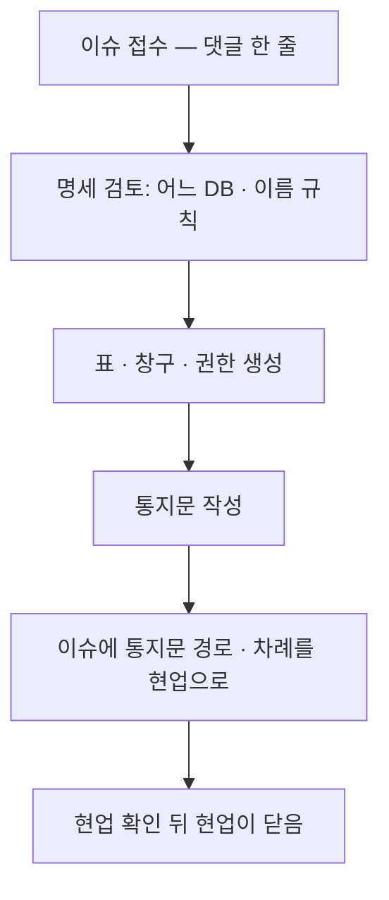

# DB 운영

> 읽는 사람: 전산팀

## 역할

| 무엇 | 현업이 하는 것 | 전산팀이 하는 것 | 요청 방법 |
| --- | --- | --- | --- |
| 표 · 칸 | 명세 작성 | 검토 · 생성 · 권한 | 이슈 「DB 요청」 |
| 읽기 · 쓰기 창구 | 화면 연결 | 백엔드에 창구 추가 · 배포 | 이슈 「DB 요청」 |
| 회신 | 확인 · 이슈 닫기 | 통지문 작성 | — |
| DB 서버 | — | 운영 · 알림 대응 | — |

## 「DB 요청」 처리 차례

## 통지문에 꼭 넣는 것

- [ ] 표 · 칸
- [ ] 창구(인자 · 결과 칸)
- [ ] 오류 코드
- [ ] 샘플 요청 · 응답 (지어낸 값)

## 지키는 것

| 원칙 | 내용 |
| --- | --- |
| 앱은 DB 에 직접 붙지 않음 | 데이터는 백엔드 창구로만 |
| 앱 계정은 표를 만들지 못함 | 표 생성 · 변경은 전산팀 |
| 이슈 · 통지문에 적지 않음 | 접속 주소 · 계정 · 조회 결과 원본 · 개인정보 |
| 회신했다고 닫지 않음 | 닫기는 현업 |

## DB 알림

| 알림 | 기준 | 등급 | 할 일 |
| --- | --- | --- | --- |
| 사내 DB 연결 실패 | 5분 5건 이상 | 긴급 | 사내망 연결 → DB 리스너 · 세션 확인 |
| 공용 DB 응답 없음 | 생존 신호 끊김 | 긴급 | 서버 상태 · 유지보수 여부 확인 |
| 공용 DB 접속 자리 부족 | 동시 접속 40 이상 (최대 50) | 주의 | 접속 누수 · 풀 설정, 사양 검토 |
| 공용 DB 저장공간 | 80% 초과 | 주의 | 용량 증설 · 자동 증가 |
| 공용 DB 메모리 | 30분 평균 90% 초과 | 주의 | 시간대 작업 확인 |
| 공용 DB 과부하 | 15분 평균 CPU 80% 초과 | 주의 | 무거운 쿼리 확인 |
| 앱의 DB 연결 실패 | 10분 3건 이상 | 긴급 | 위 항목부터 확인 |
| 데이터 적재 작업 실패 · 미실행 | 실패 1건 / 마지막 실행 뒤 26시간 | 긴급 / 주의 | 실행 기록 확인 |

- 여러 백엔드에서 사내 DB 연결 실패가 **동시에** 나면 사내망 연결 문제입니다.

정본: 각 앱 저장소의 DB 요청 · 통지문 서식, 공통 표준 문서
