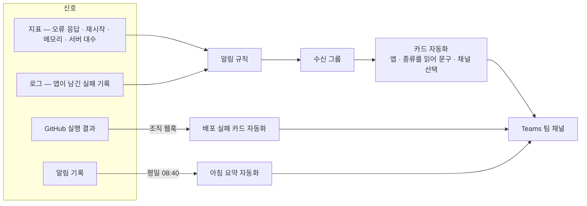

# 모니터링 구성

> 읽는 사람: 전산팀

## 구성 그림

| 구성 요소 | 하는 일 |
| --- | --- |
| 알림 규칙 | 기준을 넘으면 울림. 지표 규칙과 로그 규칙 두 가지 |
| 수신 그룹 | 모든 규칙의 알림을 카드 자동화로 넘김 |
| 카드 자동화 | 규칙 이름에서 **앱**과 **종류**를 읽어 채널 · 담당 · 문구를 고름 |
| 배포 실패 카드 자동화 | GitHub 실행 결과 중 main 가지 실패만 카드로 |
| 아침 요약 자동화 | 지난 알림 기록을 앱별 한 줄로 모아 채널마다 한 장 (읽기 전용 권한) |

## 규칙 이름이 곧 설정

| 규칙 | 내용 |
| --- | --- |
| 이름 꼴 | `<앱 키>-<종류>` — 마지막 `-` 뒤가 종류, 앞이 앱 키 |
| 여러 앱을 한 규칙으로 보는 로그 규칙 | 앱 차원으로 쪼개 앱마다 따로 울림. 앱 키는 그 차원에서 읽음 |
| 사전에 없는 종류 | 기본 문구로 전산팀 채널에 감 |

## 등급

| 규칙 심각도 | 카드 | 가는 곳 |
| --- | --- | --- |
| 0 · 1 | 🔴 긴급 | 앱 채널 + 전산팀 채널 + 같이 멈추는 앱의 팀 채널 |
| 2 | 🟠 주의 | 앱 채널 |
| 3 | 🟡 참고 | 앱 채널 |

## 앱마다 거는 것

| 알림 | 신호 | 기준 | 심각도 | 조건 |
| --- | --- | --- | --- | --- |
| 오류 응답 발생 | 지표 | 15분 합계 5건 초과 | 2 | 모든 앱 |
| 서버 재시작 반복 | 지표 | 15분 2회 초과 | 1 | 모든 앱 |
| 메모리 부족 임박 | 지표 | 15분 평균 85% 초과 | 2 | 모든 앱 |
| 서버 내려감 | 지표 | 5분 평균 1대 미만 | 1 | 최소 서버 대수 1 이상인 앱만 |
| 메모리 부족 종료 의심 | 로그 | 메모리 부족 오류 1건, 또는 강제 종료 1시간 2건 | 2 | 모든 앱 (한 규칙) |
| 백엔드 응답 없음 | 로그 | 10분 5건 이상 | 2 | 실패 기록을 남기는 앱 |
| 로그인 장애 의심 | 로그 | 10분 5건 이상 | 1 | 실패 기록을 남기는 앱 |
| DB 연결 실패 | 로그 | 10분 3건 이상 | 1 | DB 를 직접 쓰는 앱 |
| 작업 멈춤 의심 | 로그 | 성공 기록 2시간 부재 | 1 또는 3 | 정기 작업이 있는 앱 |
| 정기 작업 실패 · 미실행 | 로그 | 작업마다 정함 | 1 ~ 2 | 정기 작업이 있는 앱 |

- 서버가 0대까지 줄어드는 앱에 「서버 내려감」을 걸면 매번 잘못 울립니다.
- 실패 기록이 없는 앱은 로그 규칙을 걸 수 없습니다 → 「로그 부족 — 코드 개선 필요」 안내를 한 번 보냅니다.

## 알아 둘 한계

| 한계 | 내용 |
| --- | --- |
| 상태 확인 주소는 얕음 | 대부분 「떠 있다」만 답함. 백엔드 · DB 장애는 로그 규칙으로 잡음 |
| 트래픽이 없으면 조용함 | 실패 기록 기반 알림은 아무도 안 쓰는 시간에 울리지 않음 |
| 로그 문구에 의존 | 앱이 기록 이름을 바꾸면 규칙도 고쳐야 함 |
| 공휴일 | 업무 시간에만 도는 작업의 멈춤 감지는 공휴일에 잘못 울림 |
| 로그 수집 상한 | 하루 상한에 닿으면 로그 규칙이 전부 멈춤 — 별도 알림으로 감시 |
