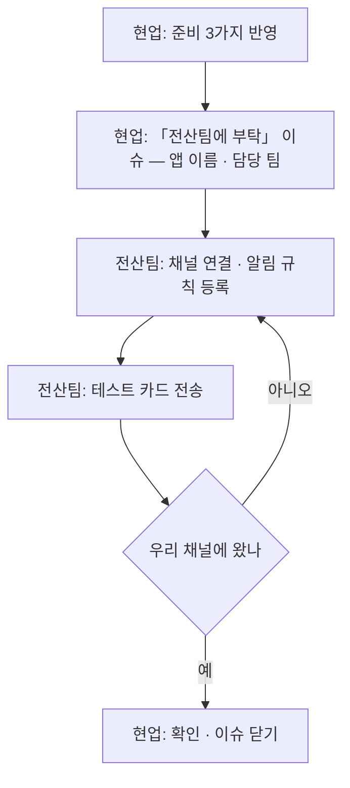

# 새 앱을 올릴 때

> 읽는 사람: 현업 · 전산팀

정식 배포하는 앱은 모두 모니터링에 등록합니다. PC 에서 돌던 작업을 Azure 로 옮길 때도 같습니다.

## 역할

| 무엇 | 현업이 하는 것 | 전산팀이 하는 것 | 요청 방법 |
| --- | --- | --- | --- |
| 앱 준비 | 아래 3가지를 코드에 넣음 | 무엇을 남길지 안내 | — |
| 등록 | 담당 팀 · 앱 이름을 알림 | 저장소 · Azure · 채널 · 알림 등록 | 이슈 「전산팀에 부탁」 |
| 확인 | 테스트 카드가 우리 채널에 오는지 봄 | 테스트 카드 전송 | — |

## 현업이 준비할 3가지

### 1. 실패하면 한 줄 기록

- 백엔드 · 외부 서비스 호출이 실패하면 **기록(로그) 한 줄**을 남깁니다.
- 한 줄에 **무슨 일인지(이름)**와 **결과(상태 코드)**가 들어가야 합니다.

| | 예 | 왜 |
| --- | --- | --- |
| 좋음 | `backend.error` 상태 503, 어느 기능 | 이름으로 찾을 수 있고 원인이 보임 |
| 좋음 | `backend.timeout` 60초 초과 | 무응답과 오류를 가를 수 있음 |
| 나쁨 | (아무것도 안 남김) | 장애가 나도 원인별 알림을 못 검 |
| 나쁨 | 「오류가 발생했습니다」 한 문장만 | 문구가 바뀌면 알림이 깨짐 |
| 나쁨 | 기록에 이름 · 사번 · 비밀을 넣음 | 로그는 여러 사람이 봄 |

### 2. 상태 확인 주소

- 「앱이 떠 있다」를 답하는 주소 하나를 둡니다(표준 틀에 이미 있음).
- 배포할 때 새 버전이 뜨는지 이 주소로 확인합니다.

### 3. 정기 작업은 성공 · 실패 기록

- 정해진 시간에 도는 작업은 **끝날 때마다** 성공 · 실패를 한 줄로 남깁니다.
- 멈춰도 오류가 안 나는 작업이라, 「성공 기록이 끊겼다」로 멈춤을 잡습니다.

| | 예 |
| --- | --- |
| 좋음 | 작업 끝에 `job.end` 성공 / 실패, 처리 건수 |
| 나쁨 | 실패했을 때만 기록 (멈춘 것과 조용한 것을 못 가름) |

## PC 에서 돌던 작업을 옮길 때

| 확인할 것 | 까닭 |
| --- | --- |
| PC 가 켜져 있어야 도는 작업인가 | Azure 에서는 예약 작업으로 바꿈 |
| 결과를 PC 폴더 · 엑셀에 쓰는가 | 저장 위치를 DB · 파일 저장소로 바꿔야 함 → 「DB 요청」 |
| 성공 · 실패를 기록으로 남기는가 | 없으면 옮긴 뒤 멈춰도 아무도 모름 |
| PC 에 저장된 계정 · 비밀을 쓰는가 | 코드에 옮겨 적지 않고 전산팀에 요청 |

## 등록 흐름

## 등록되면 받는 것

- [ ] 공통 알림: 오류 응답 · 서버 재시작 · 메모리
- [ ] 배포 · 예약 작업 실패 카드
- [ ] 평일 아침 요약 카드
- [ ] (기록이 있으면) 백엔드 응답 없음 · 로그인 · 정기 작업 알림
- [ ] (기록이 없으면) 「로그 부족 — 코드 개선 필요」 안내 1회
