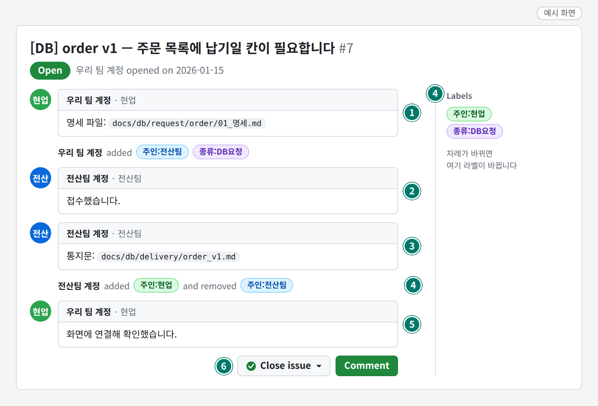
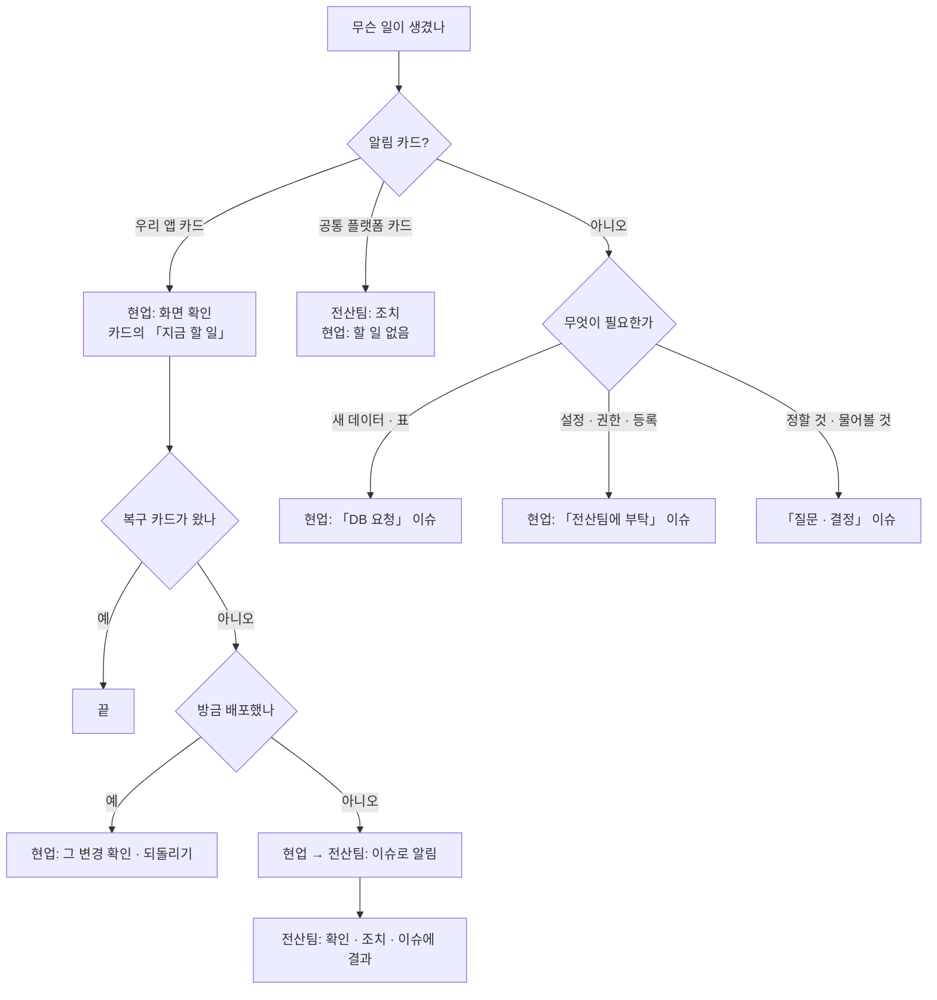

# 내가 하는 일 · 전산팀이 하는 일

> 읽는 사람: 현업 · 전산팀

## 한 줄로

- **현업**은 우리 팀 앱을, **전산팀**은 앱이 올라가 있는 바닥(로그인 · 백엔드 · DB · Azure)을 맡습니다.
- 서로에게 필요한 것은 **GitHub 이슈**로 주고받습니다.

## 이슈로 주고받는 모습

- **예시 화면**입니다. 계정 이름 · 파일 이름은 지어낸 것입니다.

| 번호 | 누가 | 무엇 |
| --- | --- | --- |
| ① | 현업 | 이슈를 엶 (전산팀 차례) |
| ② ③ | 전산팀 | 접수 → 처리 → 회신 |
| ④ | 전산팀 | 라벨을 `주인:현업` 으로 — 현업 차례 |
| ⑤ ⑥ | 현업 | 화면에서 확인하고 **현업이 닫음** |

- 화면으로 따라 하기: [요청하는 법(이슈)](issues.md)

## 영역별 역할

| 무엇 | 현업이 하는 것 | 전산팀이 하는 것 | 요청 방법 |
| --- | --- | --- | --- |
| 앱 화면 · 기능 | 만들고 고침 | 공통 부품 · 표준 제공 | 이슈 |
| 코드 저장소 | 우리 팀 저장소에 올림 | 저장소 · 팀 · 권한 설정 | 이슈 「전산팀에 부탁」 |
| 운영 반영(배포) | develop → main 으로 합침 | 배포 길 준비 · 고장 시 조치 | 이슈 「전산팀에 부탁」 |
| 데이터(표 · 조회 · 저장) | 명세를 써서 요청, 화면 연결 | 표 · 창구 · 권한 생성, 회신 | 이슈 「DB 요청」 |
| 로그인 | — | 운영 | 이슈 |
| Azure 자원 · 설정 · 비밀 | — (권한 없음) | 전부 | 이슈 「전산팀에 부탁」 |
| 파일 저장 | 화면에서 올리기 기능 사용 | 저장소 · 창구 준비 | 이슈 「DB 요청」 |
| 알림 | 우리 팀 채널 카드 확인, 앱 문제 조치 | 알림 설정, 플랫폼 문제 조치 | 이슈 |
| 실패를 기록으로 남기기 | 코드에 넣음 | 무엇을 남길지 안내 | — |

영역별 자세한 표: [GitHub](github.md) · [요청하는 법](issues.md) · [DB](db.md) · [Azure](azure.md) · [알림](cards.md)

## 상황별 — 누가 움직이나

| 상황 | 현업 | 전산팀 |
| --- | --- | --- |
| 우리 앱 알림 카드가 옴 | 화면 확인 → 카드의 「지금 할 일」 | 요청이 오면 지원 |
| 긴급 카드가 옴 | 바로 확인 · 전산팀에 알림 | 같이 확인 |
| 「백엔드 응답 없음」 · 「로그인 장애 의심」 · 「DB 연결 실패」 | 잠시 뒤 다시 해 보고, 안 되면 알림 | 원인 확인 · 조치 |
| 공통 플랫폼 카드가 우리 채널에도 옴 | 할 일 없음 (앱이 안 되는 까닭으로 알아 둠) | 조치 · 복구 |
| 배포 실패 카드 | 실행 기록에서 실패한 단계 확인 → 고쳐서 다시 올림 | 권한 · 연결 문제면 조치 |
| 「로그 부족 — 코드 개선 필요」 안내 | 실패 시 한 줄 기록을 남기게 코드 수정 | 그 기록으로 알림 추가 |
| 새 데이터가 필요함 | 명세 작성 → 「DB 요청」 이슈 | 표 · 창구 생성 → 회신 |
| 새 앱을 올림 | [준비 3가지](new-app.md) | 등록 · 알림 연결 |
| 알림이 잘못 온 것 같음 | 언제 · 어떤 카드인지 이슈로 | 기준 · 채널 수정 |
| 담당 팀이 바뀜 | 새 담당을 알림 | 권한 · 카드 담당 수정 |

## 하지 않는 것

| 누가 | 하지 않는 것 | 까닭 |
| --- | --- | --- |
| 현업 | main 에 직접 올리기 | 합치는 순간 운영에 배포됨 |
| 현업 | 비밀(키 · 비밀번호) · 업무 데이터 파일을 저장소 · 이슈 · 채팅에 적기 | 남으면 지워도 흔적이 남음 |
| 현업 | 앱이 DB 에 직접 붙기 · 표 만들기 | 앱에 그 권한이 없음 |
| 현업 | 로그인 · 배포 설정 · 공통 부품 고치기 | 전산팀 몫. 조용히 깨짐 |
| 현업 | 알림이 시끄럽다고 채널 알림 끄기 | 대신 기준 조정을 요청 |
| 전산팀 | 현업 앱 코드를 말없이 고치기 | 이슈로 알리고 맡김 |
| 전산팀 | 회신했다고 이슈를 대신 닫기 | 확인 · 닫기는 현업 |

## 정본은 어디

| 무엇 | 정본 |
| --- | --- |
| 이슈 여는 법 · 차례 넘기기 · 닫기 | 각 앱 저장소의 표준 문서 「협업 방식」 |
| 가지 · 배포 · 되돌리기 | 각 앱 저장소의 「작업 · 배포 절차」 |
| GitHub 조직 · 팀 · 권한 | 조직의 GitHub 거버넌스 문서 |

- 이 문서는 요약입니다. 어긋나면 정본을 따릅니다.
